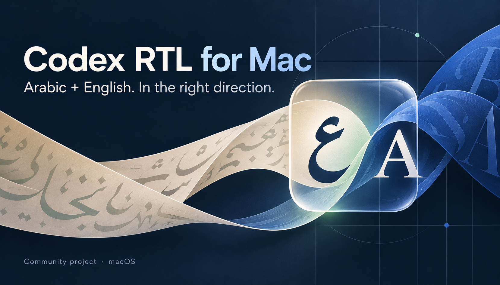
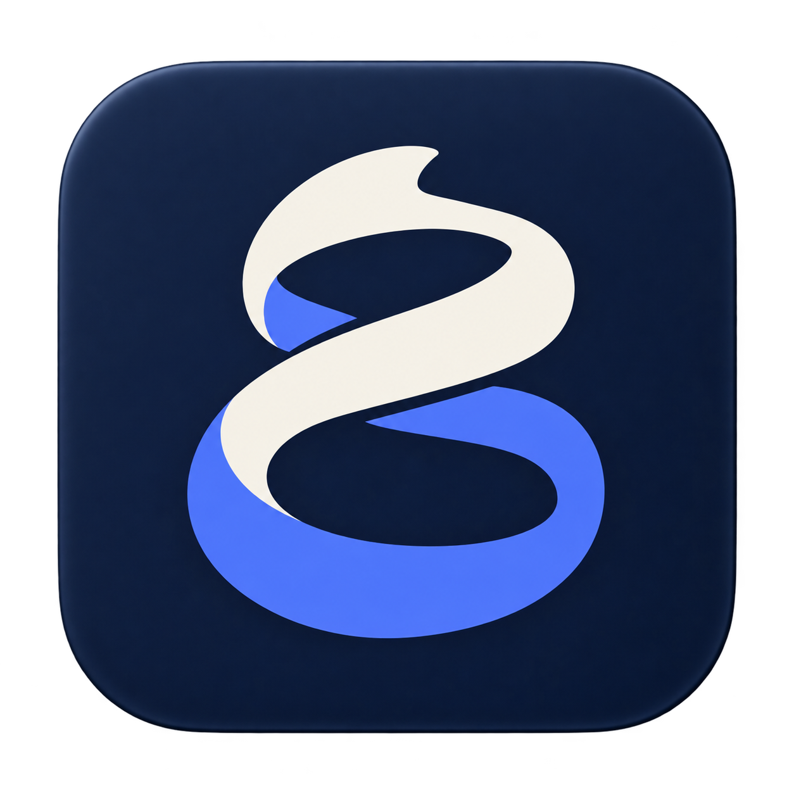
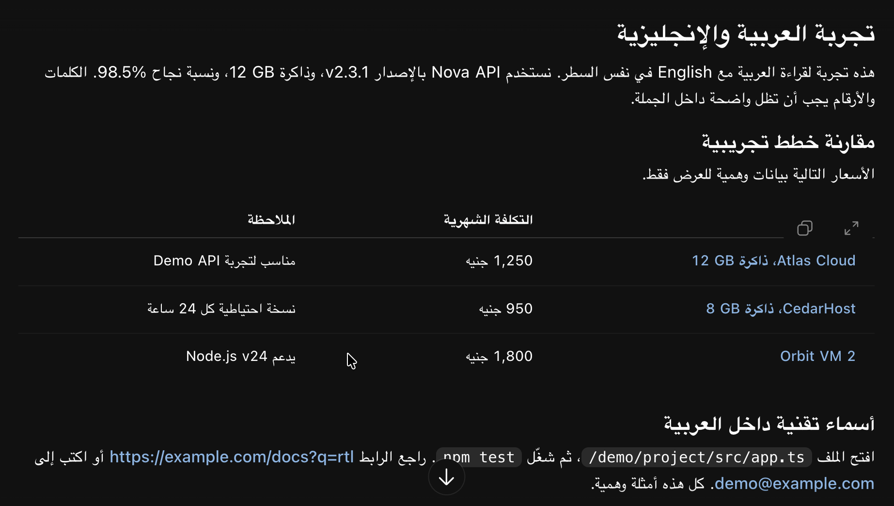
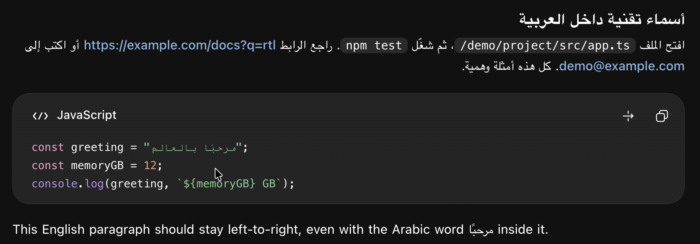

# Codex RTL for Mac

[Download the Mac app](https://github.com/ahmedtolan2019/codex-rtl-mac/releases/latest) · [Installation](docs/installation.md) · [Security](SECURITY.md) · [Customize](docs/customization.md) · [العربية](README.ar.md)

A double-click launcher that improves Arabic-English reading in Codex on macOS. Arabic paragraphs and table columns read right-to-left. English names, `12 GB`, paths and programming code retain their left-to-right order.

The fix runs in the current renderer session. It does not patch or re-sign the official app, replace `app.asar`, or alter the app's update files. This is an independent community project, not an OpenAI product.

## Install and open

1. Choose Standard or Lite below, then [download its release ZIP](https://github.com/ahmedtolan2019/codex-rtl-mac/releases/latest) and extract it.
2. Move the chosen **Codex RTL for Mac** app to your Applications folder, or `~/Applications`.
3. Save drafts and wait for active tasks to finish, then double-click the launcher.
4. Codex opens automatically. If it is already open without the required debugging session, the launcher requests a normal quit and reopens it. It never force-quits the app.

| Edition | Choose it when | Runtime |
| --- | --- | --- |
| **Standard** | You want to extract and double-click | Includes universal Node.js for Apple silicon and Intel |
| **Lite** | Node.js 22 or newer is already installed | Uses your existing Node installation; smaller download |

Both editions run the same RTL code. Standard needs no Terminal, npm or separate Node installation. Lite checks PATH and common Homebrew, Volta and fnm locations; [configure a path](docs/installation.md#lite-and-existing-nodejs) if Finder cannot find your version manager. The launcher runs in the background without its own main window. Add your chosen edition to the Dock.

**First launch:** this community release is ad-hoc signed and is not notarized by Apple. macOS may block it. Review the [installation and verification guide](docs/installation.md#first-launch-and-macos-security) before deciding to open it. Do not disable Gatekeeper globally.

Requires macOS 13.5 or newer and a compatible official Codex desktop installation. The official app may require a newer macOS version. [Compatibility and testing scope](docs/compatibility.md).

## What changes

| Content | Behavior |
| --- | --- |
| Arabic paragraphs | RTL direction and right alignment |
| Arabic-English tables | RTL column order, consistent column alignment and 16 px padding on both sides of cells |
| English product names | LTR text while remaining aligned with the rest of their column |
| Numbers and units | Whole phrases such as `12 GB` and `8 GB` stay together in reading order |
| URLs, paths, inline and programming code | LTR isolation |
| Streamed or rebuilt messages | Reprocessed as their content or markup changes |
| Composer | Direction follows the first letter in each paragraph; editor text is not rewritten |

The main focus is Arabic mixed with English. Other Arabic-script languages use the same detector but need further testing. Hebrew rendering is not currently supported by the message detector. This does not translate the app or mirror its sidebar and window controls.

## See the rendering

Real desktop screenshots contributed by the user using the [fictional demo prompt](docs/demo-prompt.md). They were cropped losslessly to remove profile and desktop UI. No text or rendering was retouched. These show the core renderer in use; they are not a before/after pair or a separate test of both download editions.

[Open the synthetic local demo](docs/demo.html) after downloading the repository to inspect the regression cases without a signed-in app.

## Privacy and security

The renderer processes visible text locally. The launcher has no analytics, no account sign-in, no API key, no update check and no runtime internet download. Its own network calls go to `127.0.0.1:9223`. Codex's normal network behavior continues independently.

**There is a real tradeoff:** this enables a Chromium debugging port. Other processes on the same Mac can potentially use that port to read or control the app. Loopback binding prevents direct remote access, but it does not protect you from hostile local software. Never expose or forward the port. Read the [threat model](SECURITY.md) before using this on a shared or managed Mac.

The launcher checks that the expected app process owns a loopback-only listener, rejects non-local renderer targets, and refuses an occupied port. These checks reduce mistakes; they are not a security sandbox or an independent security certification.

## Stop, update or remove

- To stop RTL and close the debugging port, quit the official app completely and reopen it normally. Closing a window or deleting the launcher is not enough to end an existing debugging session.
- Use the RTL launcher again for your next RTL session. The watcher exits when the official app process exits.
- To update, quit the official app, replace this launcher with the new release, then open it.
- To uninstall, quit the official app and delete **Codex RTL for Mac.app**. Optional local logs and status files are listed in [installation](docs/installation.md#uninstall).

Official app updates can follow their normal process because its installed files are untouched. A future renderer or launch change may still break this workaround and require a launcher update.

## Guides

- [Installation, checksums, first launch and removal](docs/installation.md)
- [Troubleshooting and status files](docs/troubleshooting.md)
- [Fonts, spacing, language detection and app location](docs/customization.md)
- [How the renderer and launcher work](docs/architecture.md)
- [Build, test and contribute](CONTRIBUTING.md)
- [Publish and recover tagged releases](docs/releases.md)
- [Compatibility and known limits](docs/compatibility.md)
- [Safe demo prompt and screenshot guide](docs/demo-prompt.md)

## Inspiration and credit

This project started from [pawnsmaster/codex-rtl-toolkit](https://github.com/pawnsmaster/codex-rtl-toolkit), an MIT-licensed Windows-oriented toolkit. Its renderer was the direct starting point. This Mac version adds the app launcher, standalone packaging, table handling, nested-link fixes and regression coverage. The original MIT notice is retained.

We also investigated [mmnaderi/chatgpt-rtl](https://github.com/mmnaderi/chatgpt-rtl), previously linked as `codex-rtl`, and [aviz85/codex-desktop-rtl-patch](https://github.com/aviz85/codex-desktop-rtl-patch) as alternative approaches. Their app-patching mechanisms are not included here. [Detailed provenance and third-party notices](NOTICE.md).

The approach follows W3C guidance on [structural direction](https://www.w3.org/International/questions/qa-html-dir) and [isolating opposite-direction phrases](https://www.w3.org/International/articles/inline-bidi-markup/). Automatic language detection remains a heuristic.

MIT licensed. The cover and icon are AI-generated project artwork; they are not evidence of app behavior. [Artwork prompts and provenance](docs/artwork/README.md).
