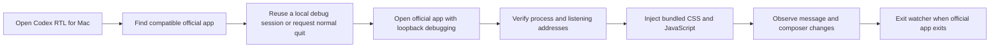

# How it works

The launcher changes the current renderer session. It does not rewrite the installed application.

## Launcher

`desktop/app-location.mjs` checks known app locations and the optional explicit path. It validates the expected bundle identifier and reads the executable name from the bundle metadata.

`desktop/macos.mjs` checks the running process and port. If the app is already in a compatible local debugging session, it focuses the app. Otherwise, it requests a normal quit, waits up to 30 seconds and opens a new session. It never uses force quit.

The watcher connects only after verifying the process's listener. It accepts local WebSocket targets for `app:` pages, injects a content-hashed revision and checks again every two seconds. A revision marker avoids reinjecting the same script into an unchanged renderer. The script itself watches DOM changes between polls.

A PID lock prevents duplicate watchers. Normal app exit ends the watch loop. A failed or cancelled startup writes a local diagnostic and may show an error dialog. No login item, daemon or scheduled task is installed.

## Paragraph and table direction

The renderer recognizes semantic Markdown containers and code elements. It does not infer code from broad class-name fragments. This matters because ordinary classes such as `text-codex-description` contain the word `code`.

Paragraphs choose a base direction. Table headers choose column direction. Each cell has its own reading direction, while alignment follows the column. An English-only product name therefore remains LTR and still sits at the same right edge as other entries in an Arabic table.

Formatting spans inside a directed paragraph or cell inherit its direction. Treating a nested link label as a separate sentence previously made English-leading mixed labels LTR. That separated a number from its unit. The native-link regression fixture covers this case.

## Inline isolation and rendering changes

Latin phrases are isolated with `bdi dir="ltr"`. Logical text is preserved; the script does not add Unicode bidi control characters to the message. A complete phrase such as `12 GB` is kept in one isolate when it is in one text node.

Short number-and-memory-unit pairs also receive `white-space: nowrap`. Isolation alone preserves direction but still allows a line break between the number and unit. Longer English phrases retain normal wrapping.

The isolation cache compares rendered markup. Text equality alone is insufficient because the app can replace an element with identical text and remove its wrappers. MutationObserver and animation-frame batching handle new or rebuilt content.

## Editable text

The ProseMirror companion sets direction per paragraph without replacing editor text nodes. It avoids damaging cursor and selection behavior. The native editor still controls difficult mixed-number cases while typing. Displayed messages receive the stronger phrase-isolation handling.

## Boundaries

This is a heuristic renderer workaround, not a complete implementation of every language's writing conventions. Unusual nested markup, mathematical layout, interactive cards and future renderer changes need separate evidence. It does not fix native window controls, CLI terminals, VS Code, browser ChatGPT or document export formats.
